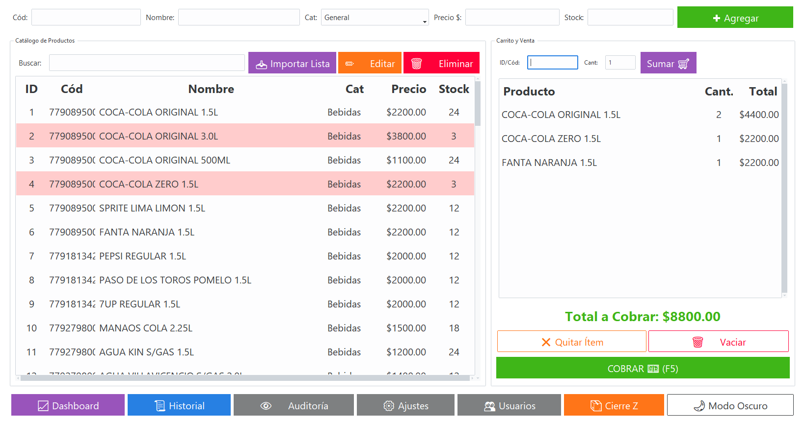
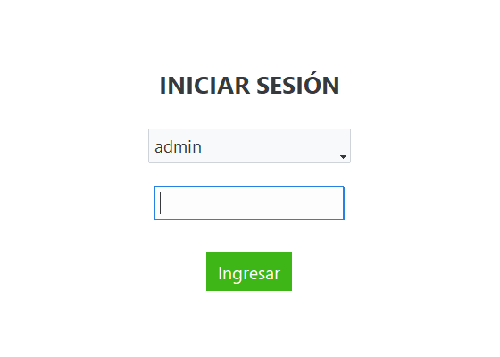
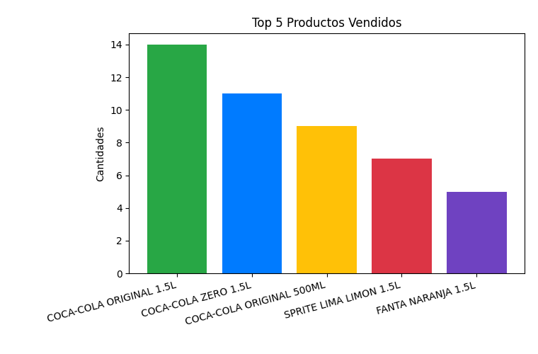

# Mi Quiosco POS — Trabajo Práctico II (Prácticas Profesionalizantes I)

Repositorio creado para el **Trabajo Práctico II** de la Tecnicatura Superior en Ciencia de Datos e Inteligencia Artificial (**Instituto Nuevos Aires**). Incluye el proyecto práctico en Python (**Mi Quiosco POS**) junto con la reflexión teórica sobre Scrum en [respuestas_scrum.md](respuestas_scrum.md).

---

## 1. Descripción general del proyecto

**Mi Quiosco POS** es una aplicación de escritorio para la gestión de ventas, inventario y caja de un comercio minorista o kiosco. El sistema separa la lógica de persistencia, seguridad, servicios externos e interfaz gráfica en módulos independientes:

- **Catálogo e inventario (`ui_productos.py`, `lista_precios.csv`):** alta, edición, búsqueda en tiempo real por código o nombre, eliminación, alertas visuales de bajo stock (`<= 5` unidades) e importación masiva desde archivo CSV (en el primer arranque carga 99 productos de ejemplo si la base está vacía).
- **Carrito y cobro (`ui_ventas.py`):** carga rápida por código/ID o doble clic, venta fraccionada por monto fijo (`$`), atajos de teclado (`F5` para cobrar, `Supr` para quitar ítems), cálculo automático de vuelto y soporte para pagos en **Efectivo**, **Billetera Virtual** o **Mixto**.
- **Facturación electrónica e impresión (`servicios.py`):** emisión de comprobantes **Ticket No Fiscal** y soporte opcional para **Factura A, B y C** ante ARCA/AFIP, además de guardado de comprobantes en `ultimo_ticket.txt` e impresión en ticketera térmica en Windows.
- **Reportes, auditoría y administración (`ui_reportes.py`, `app_runtime.py`):** dashboard con gráfico de los 5 productos más vendidos, historial de últimas 100 ventas con anulación y devolución atómica de stock, registro de auditoría, gestión de usuarios (`admin` / `cajero`), tema claro/oscuro y copias de seguridad automáticas diarias en `Backups_Quiosco/` (conserva los últimos 7 respaldos).
- **Bot de Telegram opcional (`telegram_bot.py`):** consultas remotas en segundo plano (`/caja`, `/stock`, `/cajero`, `/top`, `/mes`, `/aviso`) protegidas por `chat_id` autorizado.

---

## 2. Tecnologías utilizadas

| Categoría | Tecnología / Herramienta |
| :--- | :--- |
| **Lenguaje** | Python 3 (probado en Python 3.14; compatible con Python 3.11+) |
| **Interfaz gráfica (GUI)** | `ttkbootstrap` (tema `cosmo` / `darkly` sobre `tkinter`) |
| **Base de datos** | SQLite (`sqlite3`, librería estándar de Python) |
| **Visualización de datos** | `matplotlib` (gráfico de barras embebido en Tkinter) |
| **Integraciones opcionales** | `afip.py` (ARCA/AFIP), `pyTelegramBotAPI`, `cryptography`, `pywin32` |
| **Configuración segura** | `python-dotenv` y variables de entorno (`.env.example` + `.gitignore`) |
| **Pruebas y automatización** | `unittest`, Git, GitHub Actions y Dependabot |

---

## 3. Instrucciones para ejecutar el código

### Requisitos previos
- **Python 3.11 o superior** instalado.
- **Git** instalado para clonar el repositorio.

### Pasos de instalación y ejecución

1. **Clonar el repositorio y entrar en la carpeta del proyecto:**
   ```bash
   git clone https://github.com/eze2307/trabajo-practico-II-ina-scrum-git.git
   cd trabajo-practico-II-ina-scrum-git
   ```

2. **Crear y activar un entorno virtual (recomendado):**
   ```bash
   python -m venv .venv
   # En Windows (PowerShell):
   .venv\Scripts\Activate.ps1
   # En Linux / macOS:
   source .venv/bin/activate
   ```

3. **Instalar las dependencias:**
   ```bash
   pip install -r requirements.txt
   ```

4. **Configurar variables de entorno (opcional):**
   - Si deseas preconfigurar la clave inicial del administrador o integraciones externas sin escribir secretos en el código, copia `.env.example` a `.env` (ignorado por Git) y define los valores deseados:
     ```bash
     cp .env.example .env
     ```
   - Si no defines `KIOSCO_ADMIN_PASSWORD`, en el primer arranque del programa la pantalla de inicio de sesión te permitirá establecer la clave para el usuario `admin`.

5. **Iniciar la aplicación:**
   ```bash
   python main.py
   ```

6. **Ejecutar las pruebas unitarias:**
   ```bash
   python -m unittest discover -s tests -v
   ```

### Estructura principal del repositorio

```text
trabajo-practico-II-ina-scrum-git/
├── main.py                    # Punto de entrada de la aplicación
├── app_runtime.py             # Inicialización de BD, configuración y runtime
├── base_datos.py              # Conexión SQLite, esquema de tablas y formato numérico
├── configuracion.py           # Parámetros de ejecución leídos desde entorno
├── seguridad.py               # Hashing SHA-256, rutas seguras y backups diarios
├── servicios.py               # Facturación electrónica ARCA e impresión de tickets
├── telegram_bot.py            # Comandos opcionales de monitoreo vía Telegram
├── ui_app.py                  # Ventana principal y formulario de acceso
├── ui_context.py              # Contexto compartido entre módulos de interfaz
├── ui_productos.py            # ABM de catálogo, búsqueda e importación CSV
├── ui_ventas.py               # Carrito de compras, cobros y generación de tickets
├── ui_reportes.py             # Dashboard, historial, auditoría y ajustes
├── lista_precios.csv          # Catálogo inicial de 99 productos de ejemplo
├── capturas/                  # Capturas reales de la aplicación en ejecución
├── tests/test_pos.py          # Pruebas unitarias automatizadas
├── respuestas_scrum.md        # Parte 2: reflexión teórica sobre Scrum
├── requirements.txt           # Dependencias de Python
├── .env.example               # Plantilla de variables de entorno (sin secretos)
└── README.md                  # Documentación del proyecto
```

---

## 4. Capturas de pantalla o ejemplos de resultados

### Captura 1: Pantalla principal de punto de venta (Catálogo + Carrito)



### Captura 2: Inicio de sesión



### Captura 3: Dashboard de ventas (Top 5 productos más vendidos)



### Ejemplo 1: Ejecución de pruebas unitarias (`unittest`)

```text
test_crear_ticket_efectivo_y_con_cae (test_pos.TestMiQuioscoPOS.test_crear_ticket_efectivo_y_con_cae) ... ok
test_hashear_clave (test_pos.TestMiQuioscoPOS.test_hashear_clave) ... ok
test_inicializar_tablas_crea_esquema_completo (test_pos.TestMiQuioscoPOS.test_inicializar_tablas_crea_esquema_completo) ... ok
test_lista_precios_csv_valido (test_pos.TestMiQuioscoPOS.test_lista_precios_csv_valido) ... ok
test_parsear_numero_y_formato_limpio (test_pos.TestMiQuioscoPOS.test_parsear_numero_y_formato_limpio) ... ok

----------------------------------------------------------------------
Ran 5 tests in 0.023s

OK
```

### Ejemplo 2: Comprobante de venta generado (`ultimo_ticket.txt`)

```text
           MI NEGOCIO
         Direccion 123
================================
Fecha: 2026-11-14 14:55:00
Ticket: T-261114145500
        Ticket No Fiscal
--------------------------------
COCA-COLA ZERO  x2      $4400.00
--------------------------------
TOTAL:         $4400.00
Pago Efvo:     $5000.00
VUELTO:        $600.00
================================

    ¡Gracias por su compra!
```

### Ejemplo 3: Inicialización del esquema y catálogo base

- Tablas creadas automáticamente en SQLite: `auditoria`, `configuracion`, `productos`, `usuarios` y `ventas`.
- Carga inicial verificada desde `lista_precios.csv`: **99 productos** distribuidos por código de barras, categoría, precio y stock.

---

## 5. Conclusiones personales sobre lo aprendido

El desarrollo y la preparación de este repositorio permitieron integrar en la práctica las buenas herramientas vistas en la materia: por un lado, el manejo ordenado de **Git y GitHub** desde la terminal (`git init`, `git status`, `git add`, `git commit`, `git push`) con historial de commits claros y sin subir información sensible (protegiendo claves, bases de datos y archivos `.env` mediante `.gitignore` y variables de entorno); por otro, el valor de **documentar correctamente** un proyecto en `README.md` para que cualquier persona pueda instalarlo, entender su arquitectura y verificar su funcionamiento. Finalmente, vincular el desarrollo técnico con la **metodología Scrum** ayuda a organizar mejoras en incrementos cortos, priorizar lo que aporta más valor y mantener código modular y verificable.
